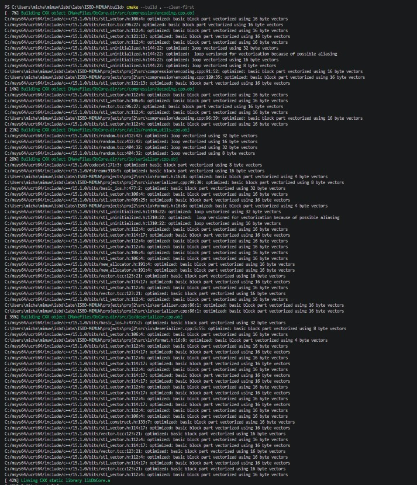
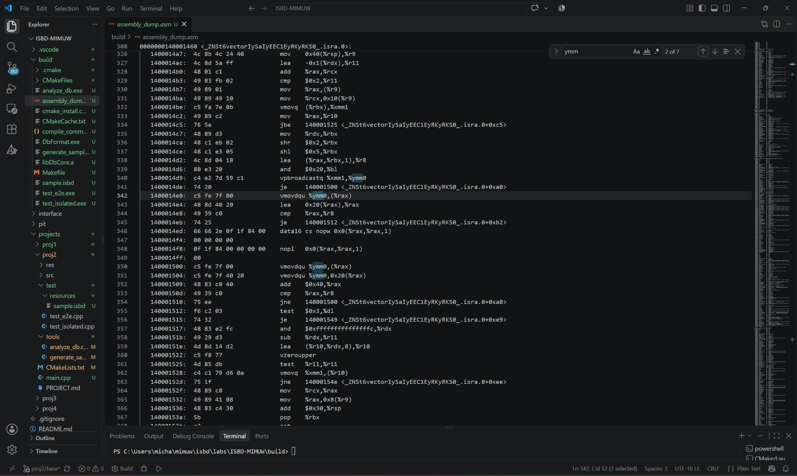

# ISBD Lab 2 - Custom Database File Format (`.isbd`)

This repository contains a custom, columnar database engine and file format implemented in C++17. The engine is designed to support arbitrary columns (INT64, BOOL, VARCHAR), data compression, and streaming data processing suitable for SIMD instructions.

## Build & Setup

### Prerequisites
- A C++17 compiler (GCC, Clang, or MSVC)
- **CMake** (v3.15+)
- **ZSTD** development libraries installed on the system

Before building on a Linux system (e.g., Ubuntu/Debian), please install the required ZSTD development package:

```bash
sudo apt-get update
sudo apt-get install libzstd-dev
```

### Compilation
---
#### Linux
The build system is configured to optimize the core database engine using `-O3` and `-march=native` (or `/O2 /arch:AVX2` on MSVC) to unlock SIMD vectorization.

Make sure you are in the folder where Makefile for proj2 is located (/proj2 root).

```bash
make all
```

To clean the build environment:

```bash
make clean
```
---
#### Windows

Make sure you are in the projects root repository (/proj2)

```bash
mkdir build
cd build
cmake ..
cmake --build . --clean-first
```

### Running the Executables
After a successful build, all executables will be located in the `build` directory. You can run them directly from your terminal. *(Note: The `.exe` extension is used on Windows. On Linux/macOS, omit the `.exe`)*.

**Run the Tests:**
```bash
./test_isolated
./test_e2e
```

**Generate the Sample Database:**

By default, this generates the required `sample.isbd` file in the `../test/resources/` directory.
```bash
./generate_sample
```
*(Optionally, you can pass a custom path: `./generate_sample custom_path/file.isbd`)*

**Analyze the Database File:**


Run the analyzer to compute the Mean, Binary Entropy, and ASCII frequencies.
```bash
./analyze_db ../test/resources/sample.isbd
```
*(If run without arguments, it will attempt to automatically find the default sample file).*

## Architectural Choices

1. **Columnar Storage (Struct of Arrays):** Data is processed and stored column-by-column. This SoA layout provides memory contiguity, which is a requirement for SIMD.
2. **Streaming & Chunking (Row Groups):** To handle datasets m larger than available RAM, the `Batch` system chunks data into bounded Row Groups. The deserializer streams these batches sequentially from disk without loading the entire file into memory.
3. **Transactional Safety:** The `Serializer` writes data to a temporary `.tmp` file. Only when the file is completely written and the final headers are flushed is the file atomically renamed to `.isbd`. This prevents corrupted data in the event of a crash.

## Project Structure & Components

### 1. `DbCore` (Core Library)
* **`encoding.cpp` / `decoding.cpp`**: Implements the column-specific compression pipelines:
  * **INT64**: Delta Encoding → ZigZag Encoding → Varint Packing.
  * **BOOL**: Branchless bit-packing (8 booleans per byte).
  * **VARCHAR**: Separated into an integer offset index blob and a ZSTD-compressed text blob.
* **`serializer.cpp` / `deserializer.cpp`**: Handles the low-level binary I/O, atomic file creation, and schema validation.

### 2. Tools
* **`generate_sample.cpp`**: Generates the requested test file (`sample.isbd`) matching the lab schema (1x INT64, 1x BOOL, 2x VARCHAR) with 100,000 rows chunked into row groups.
* **`analyze_db.cpp`**: Streams a given `.isbd` file and computes the required metrics:
  * Mean for INT64 columns.
  * Binary Entropy for BOOL columns.
  * ASCII character frequencies for VARCHAR columns ($O(1)$ array lookup).

### 3. Testing
* **`test_isolated.cpp`**: Unit tests verifying the exact bit-level encoding/decoding of individual data types without touching the disk.
* **`test_e2e.cpp`**: Integration tests that generate randomized schemas, serialize them to disk, deserialize them back, and `assert()` perfect data integrity.

## SIMD Vectorization & Performance

Because the engine utilizes Struct of Arrays (SoA) layout and branchless loops (such as the boolean `pack_booleans` and accumulator loops in `analyze_db`), the C++ compiler unrolls the loops into **AVX2 SIMD instructions**.

Below is the compiler diagnostic output confirming that loops were vectorized using 256-bit (32-byte) hardware registers:


*(Note: The compiler versions the loops to handle potential pointer aliasing, ensuring the SIMD fast-path is taken).*

By dumping the assembly code of the compiled core (`objdump -d`), we can verify the physical hardware utilization. The presence of `ymm` registers proves the CPU is processing up to 4 integers or 32 booleans simultaneously per clock cycle:

